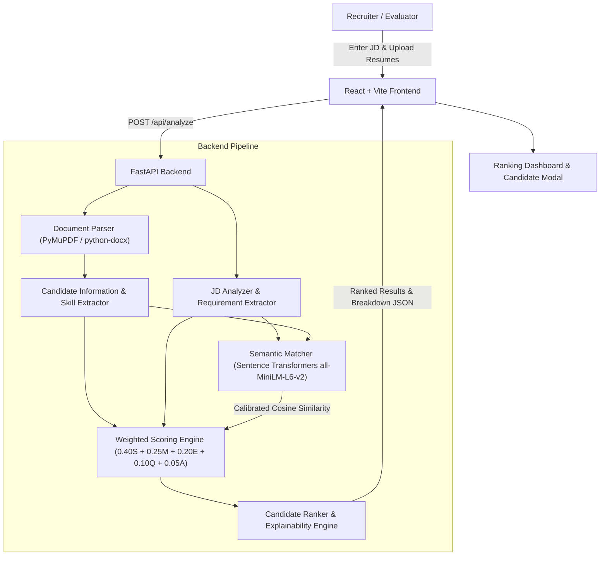

# AI-Based Resume Matching & Candidate Ranking System

A full-stack, explainable AI recruitment screening prototype built for the **Avom Consultants** technical assessment. The application parses candidate resumes (PDF and DOCX), analyzes job descriptions (JD), extracts skills and metadata, generates dense semantic embeddings, computes explainable multi-factor weighted scores, and presents ranked candidates in a responsive React dashboard.

---

## 📌 Architecture & Workflow



---

## 🛠️ Technology Stack & Verified Versions

| Layer | Technology | Version | Purpose in Prototype |
| :--- | :--- | :--- | :--- |
| **Frontend** | React | `^19.1.0` | UI views, upload zone, interactive ranking table, detailed modal |
| **Tooling & Bundler** | Vite | `^6.3.5` | Development server, dev proxy to `:8000`, production build |
| **HTTP Client** | Axios | `^1.7.0` | Multipart form uploads with real-time progress events |
| **Styling** | Custom Clean CSS | — | Responsive cards, score badges, progress bars, modal overlays |
| **Backend Framework** | FastAPI | `0.135.1` | REST API routes, Pydantic validation, CORS middleware |
| **ASGI Web Server** | Uvicorn | `0.42.0` | Asynchronous runtime server with lifespan model loading |
| **PDF Extraction** | PyMuPDF (`pymupdf`) | `2.1` / `1.23+` | Direct text extraction from text-based PDF documents |
| **DOCX Extraction** | `python-docx` | `1.2.0` | Text extraction from Word document paragraphs and tables |
| **Semantic Embeddings** | Sentence Transformers | `6.3.0` | Dense 384-dimensional text embeddings (`all-MiniLM-L6-v2`) |
| **Similarity Metrics** | Scikit-learn | `1.8.0` | Pairwise cosine similarity calculation |
| **Data Handling** | Pydantic / Pandas | `2.12.5` / `2.3.3` | Schema validation, score aggregation, and ranking |
| **Storage** | In-Memory Dictionary | — | Active session results cache (`_analyses` in memory) |

---

## 🎯 Scoring Methodology & Algorithmic Formulation

Every candidate receives an overall weighted match score between $0$ and $100$ following the specification defined in PRD/SRS §6.2:

$$\text{Overall Score} = 0.40S + 0.25M + 0.20E + 0.10Q + 0.05A$$

All five component scores are normalized to a $0–100$ scale before applying weights.

### 1. Skills Matching ($S$ — 40% weight)
- Evaluates coverage of required and preferred skills extracted from the job description.
- Extracted resume skills and JD skills are mapped to canonical identifiers using a comprehensive alias dictionary (`backend/app/services/skill_extractor.py`). Examples:
  - `FastAPI`, `fast api`, `FastAPI framework` → `fastapi`
  - `React`, `reactjs`, `react.js`, `react js` → `react`
  - `PostgreSQL`, `postgres`, `psql`, `pg` → `postgresql`
  - `Docker container`, `containerization` → `docker`
- **Formula**: $S = \min\left(100, \frac{|K_{\text{matched}}|}{|K_{\text{JD}}|} \times 100\right)$.
- If the JD specifies no skills, $S = 100.0$ (neutral rule; no penalty for unspecified JD criteria).

### 2. Semantic Similarity ($M$ — 25% weight)
- Generates 384-dimensional dense semantic vectors using `SentenceTransformer("all-MiniLM-L6-v2")`.
- **Performance Optimization (NFR-004)**: The embedding model is loaded once at backend startup (`preload_model`). During batch analysis, the Job Description embedding is computed once and reused across all candidate resumes to prevent redundant vector encoding.
- **Piecewise Linear Cosine Calibration**: Raw cosine similarity between domain-specific texts typically falls in the range $[0.1, 0.8]$. Presenting raw cosine similarity directly as a percentage would distort human expectations. The system maps raw cosine similarity $c$ to an intuitive $0–100$ component score via a 5-stage monotonic calibration:
  - $0.0 \le c < 0.1 \implies \text{score} = c \times 100$ (negligible relevance)
  - $0.1 \le c < 0.3 \implies \text{score} = 10.0 + (c - 0.1) \times 150.0$ (low relevance)
  - $0.3 \le c < 0.5 \implies \text{score} = 40.0 + (c - 0.3) \times 125.0$ (moderate relevance)
  - $0.5 \le c < 0.7 \implies \text{score} = 65.0 + (c - 0.5) \times 100.0$ (strong relevance)
  - $0.7 \le c \le 1.0 \implies \text{score} = 85.0 + (c - 0.7) \times 50.0$ (exceptional alignment)

### 3. Relevant Experience ($E$ — 20% weight)
- Extracts candidate total/relevant experience years using regex and employment date ranges.
- **Scoring Rules**:
  - If the JD specifies no minimum experience requirement: $E = 100.0$ (no arbitrary penalty).
  - If candidate experience $Y_{\text{cand}} \ge Y_{\text{required}}$: $E = 100.0$.
  - If candidate experience $Y_{\text{cand}} < Y_{\text{required}}$: $E = \max\left(0, \frac{Y_{\text{cand}}}{Y_{\text{required}}} \times 100\right)$ (proportional partial credit).
  - If candidate experience cannot be identified from the document: $E = 50.0$ (neutral baseline; explicitly noted in the explanation).

### 4. Education & Qualifications ($Q$ — 10% weight)
- Evaluates candidate degree levels against the stated JD requirement threshold using a 5-tier classification:
  $$\text{Ph.D. (5)} > \text{Master's / M.Tech / MS / MBA (4)} > \text{Bachelor's / B.Tech / BS / BE (3)} > \text{Diploma / Associate (2)} > \text{Certificate (1)}$$
- **Important Qualification Matching Principle**:
  - **Threshold Fulfillment**: If the candidate's degree level **meets or exceeds** the JD requirement (`candidate_level >= jd_level`), they receive full base credit ($100.0$). For example, a candidate with a Bachelor's degree and a candidate with a Master's degree applying for a Bachelor's-level position both receive $100.0$ base points. Higher degrees do not outscore candidates who already satisfy the requirement.
  - **Partial Credit**: If the candidate's degree level is one level below requirement (e.g., Bachelor applying for Master's): Base score = $75.0$. Other identifiable degrees below requirement: Base score = $50.0$.
  - **No Stated Degree in JD**: $Q = 100.0$ if candidate holds any degree, or $70.0$ otherwise.
  - **Discipline Alignment Bonus**: $+10$ points (capped at 100) when degree fields match (e.g., Computer Science, Software Engineering, IT).

### 5. Additional Requirements ($A$ — 5% weight)
- Checks candidate resumes for secondary requirements stated in the JD (e.g., Agile/Scrum workflows, microservices architecture, containerization).
- If the JD contains no additional requirements: $A = 100.0$.
- Otherwise: $A = \frac{\text{matched requirements}}{\text{total additional requirements}} \times 100$.

*For complete details and edge-case handling rules, see [MATCHING_ALGORITHM.md](./MATCHING_ALGORITHM.md).*

---

## 🚀 Setup & Execution Guide

All commands below must be executed from the project root:
```powershell
Set-Location "c:\Users\Roopesh\OneDrive\Desktop\AI resume matcher & Candidate ranking system\AI-Resume-Matcher"
```

### Prerequisites
- Python 3.10+ (tested on Python 3.13)
- Node.js 18+ and npm (tested on Node.js v24.14)

---

### Step 1: Backend Setup & Startup (Terminal 1)

1. Open PowerShell and navigate to the project root:
   ```powershell
   Set-Location "c:\Users\Roopesh\OneDrive\Desktop\AI resume matcher & Candidate ranking system\AI-Resume-Matcher"
   ```

2. Install Python dependencies using `python -m pip` (avoids Windows Application Control restriction on standalone `pip.exe`):
   ```powershell
   python -m pip install -r backend/requirements.txt
   ```

3. Launch the FastAPI server using `python -m uvicorn` (avoids Application Control restriction on standalone `uvicorn.exe`):
   ```powershell
   python -m uvicorn backend.app.main:app --host 127.0.0.1 --port 8000 --reload
   ```

   The backend preloads the embedding model into memory and starts listening:
   - **API Base**: `http://127.0.0.1:8000`
   - **Health Check**: `http://127.0.0.1:8000/api/health`
   - **Interactive API Documentation (Swagger)**: `http://127.0.0.1:8000/docs`
   - **ReDoc Documentation**: `http://127.0.0.1:8000/redoc`

---

### Step 2: Frontend Setup & Startup (Terminal 2)

1. Open a second PowerShell terminal and navigate to the `frontend` directory:
   ```powershell
   Set-Location "c:\Users\Roopesh\OneDrive\Desktop\AI resume matcher & Candidate ranking system\AI-Resume-Matcher\frontend"
   ```

2. Install npm dependencies using `npm.cmd` (avoids PowerShell ExecutionPolicy restrictions on `npm.ps1`):
   ```powershell
   npm.cmd install
   ```

3. Start the Vite development server:
   ```powershell
   npm.cmd run dev
   ```
   *(Alternative direct invocation: `node node_modules/vite/bin/vite.js`)*

4. Open your browser at `http://localhost:5173`.
   - The Vite development server automatically proxies `/api` calls to `http://127.0.0.1:8000`.

---

## 🧪 Automated Testing & Verification

A dedicated automated test suite (`test_system.py`) verifies the entire backend, matching pipeline, and error handling against all PRD and SRS requirements.

### Running the Test Suite
```powershell
Set-Location "c:\Users\Roopesh\OneDrive\Desktop\AI resume matcher & Candidate ranking system\AI-Resume-Matcher"
python test_system.py
```

### Verified Test Cases (Mapped to SRS §10)
| Test ID | Test Scenario | Expected & Verified Result | Status |
| :---: | :--- | :--- | :---: |
| **TC-01** | Submit valid JD and 10+ text-based PDF resumes | All 12 PDF resumes parsed and scored successfully | ✅ PASSED |
| **TC-02** | Submit valid JD and DOCX resume | `Resume_Siddharth_Mukherjee.docx` parsed and scored | ✅ PASSED |
| **TC-03** | Batch mix of PDF, DOCX, and invalid file (`.txt`) | Valid files processed; invalid file receives file-level error | ✅ PASSED |
| **TC-04** | Synonym & alias matching for JD skills | Aliases (e.g. `fast api` → `fastapi`) normalized and matched | ✅ PASSED |
| **TC-05** | Resume omits required JD skills | Missing skills accurately listed as "not identified" | ✅ PASSED |
| **TC-06** | Candidate experience below JD requirement | Proportional experience score calculated without crashing | ✅ PASSED |
| **TC-07** | JD specifies no experience or degree requirement | Neutral handling (100% credit); no unfair penalty applied | ✅ PASSED |
| **TC-08** | Resume lacks optional candidate fields | Missing fields marked "Not identified" without failure | ✅ PASSED |
| **TC-09** | Detailed candidate view and explanation | Component breakdown and evidence-based explanation returned | ✅ PASSED |
| **TC-10** | Submit empty JD | Analysis blocked with HTTP 400/422 validation message | ✅ PASSED |
| **TC-12** | Inspect candidate ranking order | Candidates strictly sorted in descending score order | ✅ PASSED |

*(Note on **TC-11**: Scanned/image-only PDFs yield an extraction limitation message; OCR is deliberately excluded from the prototype scope per SRS §2.4).*

---

## 📁 Project Directory Structure

```text
AI-Resume-Matcher/
├── docs/
│   ├── AI_Resume_Matcher_PRD.pdf          # Primary Product Requirements Document
│   └── AI_Resume_Matcher_SRS.pdf          # Software Requirements Specification
│
├── backend/
│   ├── app/
│   │   ├── __init__.py
│   │   ├── main.py                        # FastAPI entry point, lifespan loader & CORS
│   │   ├── routes/
│   │   │   ├── __init__.py
│   │   │   └── analysis.py                # Endpoints: /api/analyze, /api/analysis/{id}
│   │   ├── services/
│   │   │   ├── __init__.py
│   │   │   ├── resume_parser.py           # PyMuPDF & python-docx parser & extractor
│   │   │   ├── jd_analyzer.py             # Requirement & skill parsing from JD
│   │   │   ├── skill_extractor.py         # Canonical alias dictionary & normalization
│   │   │   ├── semantic_matcher.py        # SentenceTransformer all-MiniLM-L6-v2 & calibration
│   │   │   └── scoring_engine.py          # 5-factor weighted scoring & explanation generator
│   │   └── schemas/
│   │       ├── __init__.py
│   │       └── models.py                  # Pydantic schemas (JDInfo, CandidateResult, etc.)
│   ├── generate_resumes.py                # Synthetic PDF resume generator
│   └── requirements.txt                   # Python package dependencies
│
├── frontend/
│   ├── src/
│   │   ├── components/
│   │   │   ├── ScoreBar.jsx               # Color-coded progress bar component
│   │   │   └── CandidateDetailModal.jsx   # Candidate modal with 5-score breakdown
│   │   ├── pages/
│   │   │   ├── UploadPage.jsx             # Drag & drop upload, sample JD loader
│   │   │   └── ResultsPage.jsx            # Summary metrics, ranked table, filters
│   │   ├── services/
│   │   │   └── api.js                     # Axios client with upload progress handler
│   │   ├── App.jsx                        # Main state orchestrator
│   │   ├── main.jsx                       # React DOM entry point
│   │   └── index.css                      # Modern responsive custom stylesheet
│   ├── index.html                         # Single-page HTML shell
│   ├── vite.config.js                     # Vite proxy config (port 5173 -> 8000)
│   └── package.json                       # Frontend dependencies and scripts
│
├── sample_resumes/                        # 13 synthetic test resumes (12 PDFs + 1 DOCX)
├── test_system.py                         # Automated end-to-end test suite
├── MATCHING_ALGORITHM.md                  # Comprehensive matching algorithm specification
├── README.md                              # Project documentation
├── .gitignore                             # Git ignore rules
└── .env.example                           # Sample environment configuration
```

---

## 📋 Feature Status & Scope Boundaries

### ✅ Implemented Prototype Features
- [x] Full-text and section-based extraction for PDF (`PyMuPDF`) and DOCX (`python-docx`).
- [x] Extraction of candidate contact information, education, skills, experience, and projects.
- [x] Canonical skill normalization covering programming languages, frameworks, cloud tools, and databases.
- [x] Dense semantic embedding generation with `all-MiniLM-L6-v2` loaded once into memory.
- [x] Piecewise calibrated cosine similarity mapping raw text cosine values to an intuitive 0–100 scale.
- [x] 5-factor weighted scoring engine ($0.40S + 0.25M + 0.20E + 0.10Q + 0.05A$).
- [x] Qualification matching with threshold satisfaction and discipline alignment bonus.
- [x] Non-punitive handling for unspecified JD criteria.
- [x] Natural language explanation generation detailing score evidence and gaps.
- [x] Batch resume processing supporting 10+ resumes in a single action.
- [x] File-level error isolation so individual unreadable files do not abort the batch.
- [x] MD5-based duplicate file detection.
- [x] React dashboard with upload progress, summary metrics cards, and ranked candidate table.
- [x] Detailed candidate inspection modal with visual 5-factor score breakdown.

### 🔮 Planned / Future Enhancements (Excluded from Rapid Prototype Scope)
- **Optical Character Recognition (OCR)**: Scanned image-only PDFs currently report an extraction limitation message; integration of Tesseract or cloud OCR is planned for a production phase.
- **Persistent Database**: Prototype uses in-memory session storage; PostgreSQL or MongoDB integration is reserved for multi-user deployment.
- **User Authentication & RBAC**: Recruiter login, role-based authorization, and team workspaces.
- **Recruitment Workflow Automation**: Interview scheduling, automated email notifications, and candidate status pipelines.
- **Autonomous Hiring Decisions**: System output is strictly intended for recruiter decision support; automated rejection or hiring is out of scope.

---

## 📄 Reference Documents

The original assessment specification documents are preserved in the `docs/` directory:
- [AI_Resume_Matcher_PRD.pdf](./docs/AI_Resume_Matcher_PRD.pdf) — Product Requirements Document (PRD v1.0)
- [AI_Resume_Matcher_SRS.pdf](./docs/AI_Resume_Matcher_SRS.pdf) — Software Requirements Specification (SRS v1.0)
